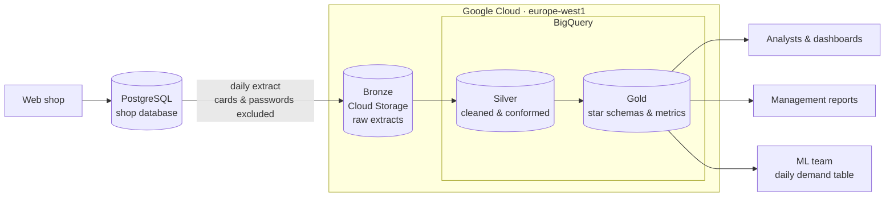

# Architecture

> Update this page at the end of every lesson. It is the diagram you present at
> the oral defence.

## Context

Albert's Marketplace is a European beauty marketplace whose web shop, analysts
and nightly spreadsheet export all depend on a single PostgreSQL database. The
data platform must serve three consumers: analysts and management, who need
revenue figures that agree; business users, who today work from CSV exports;
and the ML team, who need units sold per product, per country, per day. Daily
freshness covers all of these needs. Two constraints frame every choice: the
shop's database must stop serving analytical queries, and payment cards and
passwords must never leave it.

## Target architecture

Technologies chosen so far: BigQuery as the warehouse and Cloud Storage as
the bronze landing zone ([ADR-0001](adr/0001-target-architecture.md)).
Ingestion, transformation (dbt) and orchestration tools are added in later
lessons.

## Layers

| Layer | What lands here | What it guarantees | Who reads it |
|---|---|---|---|
| Bronze | Raw daily extracts of the source tables, as they were, with a load timestamp; cards and passwords excluded | Complete and unmodified copy of the source, append-only, so any day can be replayed | Data team only (pipelines) |
| Silver | Cleaned, typed and deduplicated tables, one per business entity (orders, order lines, customers, products, reviews) | One valid row per entity, consistent types and keys, personal data pseudonymised | Data team, ML team for exploration |
| Gold | Star schemas and business metrics (sales, daily demand, revenue) | One documented, tested definition per metric; ready to query without joins on raw tables | Analysts, management, ML team |

## Decisions

| ADR | Decision | Status |
|---|---|---|
| [0001](adr/0001-target-architecture.md) | Cloud data warehouse on BigQuery, medallion layers, bronze on Cloud Storage | Proposed |

## Change log

| Lesson | What changed |
|---|---|
| L01 | First version: target architecture, layers, ADR-0001 |
