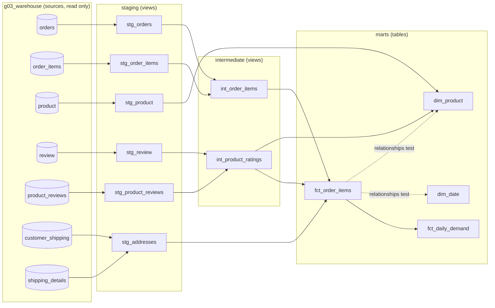

# dbt lineage

How the seven native tables in `g03_warehouse` become the daily-demand star
schema. Generated from `dbt/target/manifest.json` after `dbt docs generate`
(dbt 1.12.1, 2026-11-04). For the interactive graph, run
`dbt docs serve --host 0.0.0.0 --port 8080` in the course container and open
http://localhost:8080.

## Models

| Layer | Model | Grain | Reads from | Why it exists |
|---|---|---|---|---|
| Staging | `stg_orders` | `order_id` | `orders` | Drops the pandas index column `Unnamed__0` |
| Staging | `stg_order_items` | `order_id, p_id` | `order_items` | Selects the four line columns |
| Staging | `stg_product` | `p_id` | `product` | Renames `p_name` to `product_name` |
| Staging | `stg_review` | `review_id` | `review` | Turns 110 whitespace-only review texts into NULL |
| Staging | `stg_product_reviews` | `p_id, review_id` | `product_reviews` | Link table, keys only |
| Staging | `stg_addresses` | `c_id` | `customer_shipping`, `shipping_details` | Keeps the default address and the country only, so no street or phone goes further |
| Intermediate | `int_order_items` | `order_id, p_id` | `stg_order_items`, `stg_orders` | Adds the order date and buyer, and `is_zero_price_anomaly` on the 30 lines whose purchase price was rounded to 0.00 (the price is not replaced) |
| Intermediate | `int_product_ratings` | `p_id` | `stg_product_reviews`, `stg_review` | Aggregates reviews per product **before** any join, so order lines are not multiplied by the number of reviews |
| Mart | `fct_order_items` | `order_id, p_id` | `int_order_items`, `stg_addresses`, `int_product_ratings` | One row per product per order, with revenue (`qty * price_at_purchase`), country and `is_zero_price_anomaly` |
| Mart | `fct_daily_demand` | `p_id, country, order_date` | `fct_order_items` | The table the ML team asked for: units and revenue per product, country and day |
| Mart | `dim_product` | `p_id` | `stg_product`, `int_product_ratings` | Product name, price, average rating |
| Mart | `dim_date` | `date_day` | none (generated) | Calendar from 2023-01-01 to 2027-12-31; orders run from 2023-09-15 to 2026-09-14 |

## Where the tests sit

- **Staging** carries the grain tests (`unique`, `unique_combination_of_columns`)
  and the `stg_order_items.p_id → stg_product` relationship. In step 7 these
  stop the pipeline before any mart is rebuilt.
- **Marts** repeat the grain tests and check the foreign keys of
  `fct_order_items` against `dim_product` and `dim_date`.
- **Singular test** `assert_line_revenue_is_positive` checks that every line of
  `fct_order_items` has a revenue above zero.

Last `dbt build`: 45 nodes, PASS=44, WARN=1 (6 products without a name, severity
`warn` on purpose), ERROR=0.
