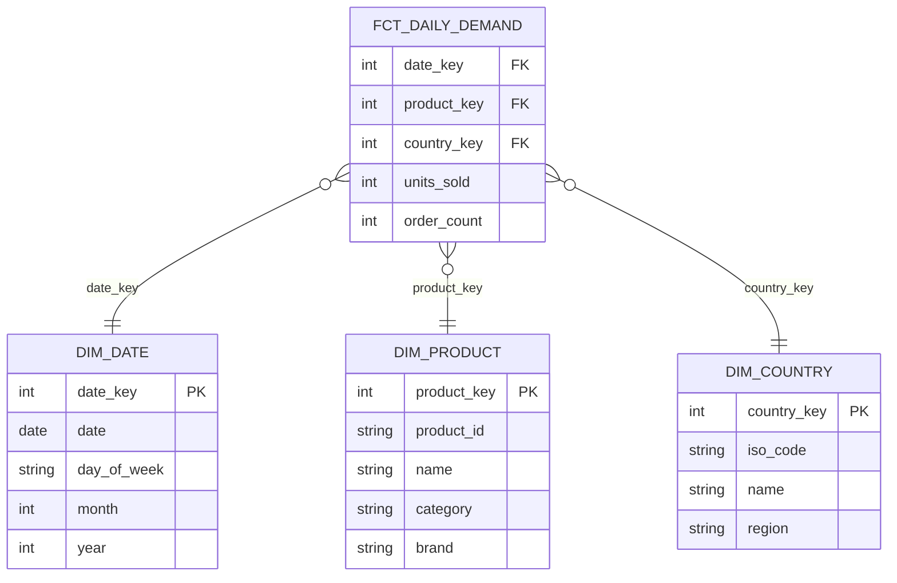

# Star schema: daily demand

The table the ML team asked for: **units sold per product, per country, per
day.** Sketched in L01, built and tested in L05.

## 1. Business process

**Selling products:** a customer places an order made of order lines, each
line being a quantity of one product shipped to one country.

## 2. Grain

**One row per product, per shipping country, per calendar day of order.**

Two definitions to fix before building:
- **Country** is the shipping country of the order, not the customer's billing
  country.
- **Day** is the order date in a single timezone (Europe/Paris), so a day
  always means the same 24 hours.

The table is **dense**: a product with no sale in a country on a given day
gets a row with zero units, because the ML team needs to see zero demand, not
missing data.

## 3. Dimensions

| Dimension | Key | Attributes |
|---|---|---|
| `dim_date` | `date_key` | date, day of week, week, month, quarter, year, is_weekend |
| `dim_product` | `product_key` | product id, name, category, brand |
| `dim_country` | `country_key` | ISO country code, country name, region |

## 4. Facts

| Fact | Meaning | Additive? |
|---|---|---|
| `units_sold` | Sum of quantities on order lines of valid orders (cancelled orders excluded) | Yes, across all dimensions |
| `order_count` | Number of distinct orders containing the product | No: an order can contain several products, so sums across products overcount |

*To confirm against the source schema: whether returns exist, which would add
`units_returned` (additive) and `net_units`.*

## Sketch

## What ingestion must carry from day one

To build this table, bronze must keep, from the first load:
- on **order lines**: order id, product id, quantity;
- on **orders**: order timestamp, status, shipping country, last-updated
  timestamp (to catch status changes such as cancellations);
- on **products**: product id, name, category, brand.

No customer identifier is needed for this table.
